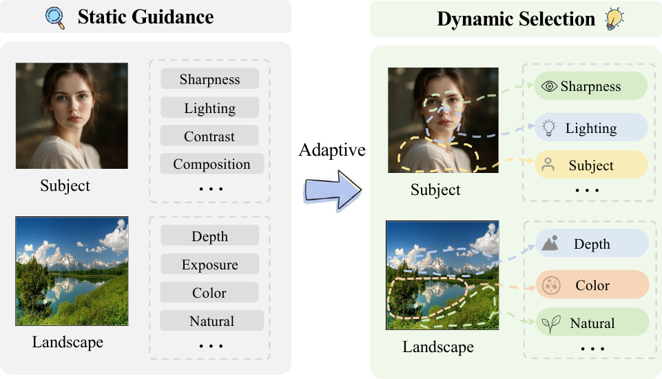

# PerGraph

Dynamic region-attribute graph reasoning for perceptual image assessment.

  
  
  

## Introduction

  

PerGraph is a dynamic region-attribute reasoning framework for perceptual image assessment. Motivated by the limitation that static semantic guidance often links attributes to the whole image without identifying their supporting regions, PerGraph selects image-relevant perceptual attributes and associates them with local visual evidence through image and text dynamic graphs. By aligning region-level features with semantic attribute cues, PerGraph provides an adaptive reasoning basis for both image quality and aesthetic assessment.
